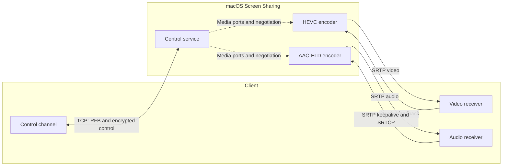
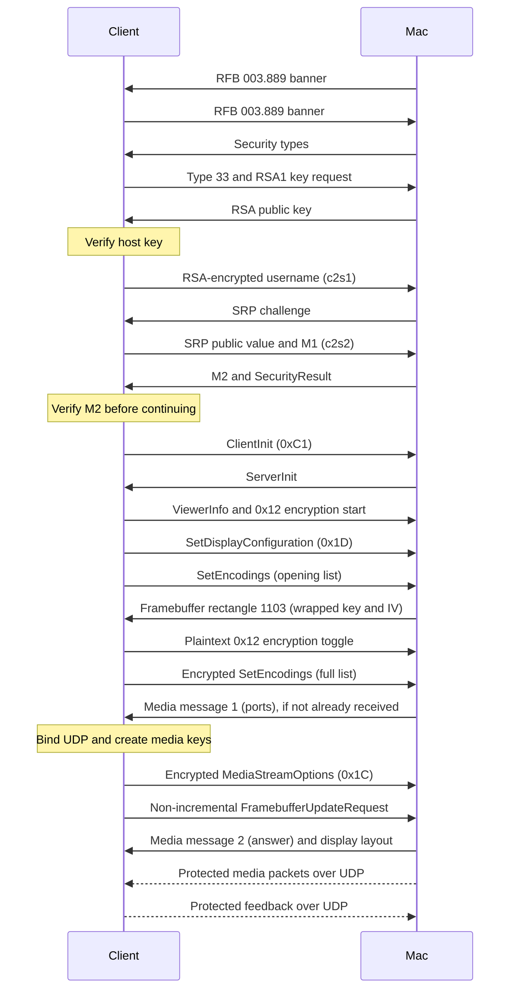
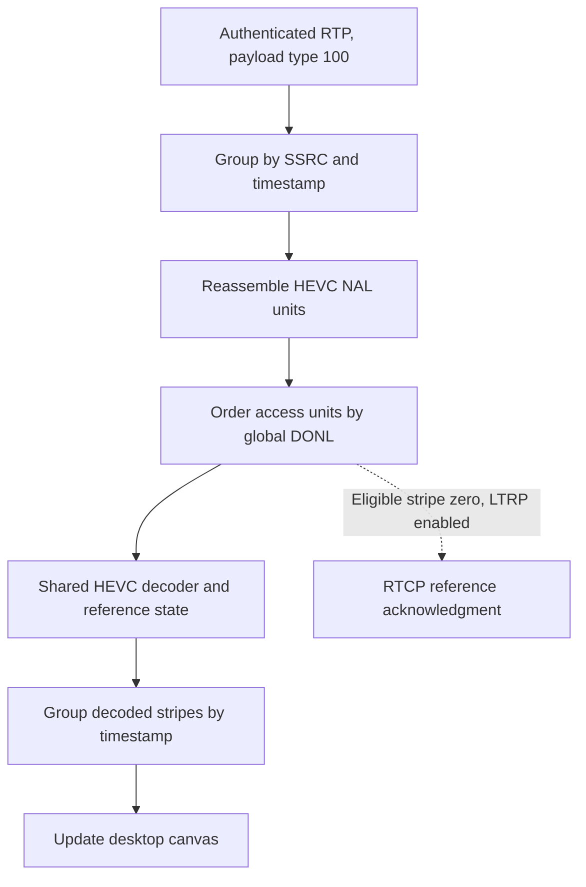
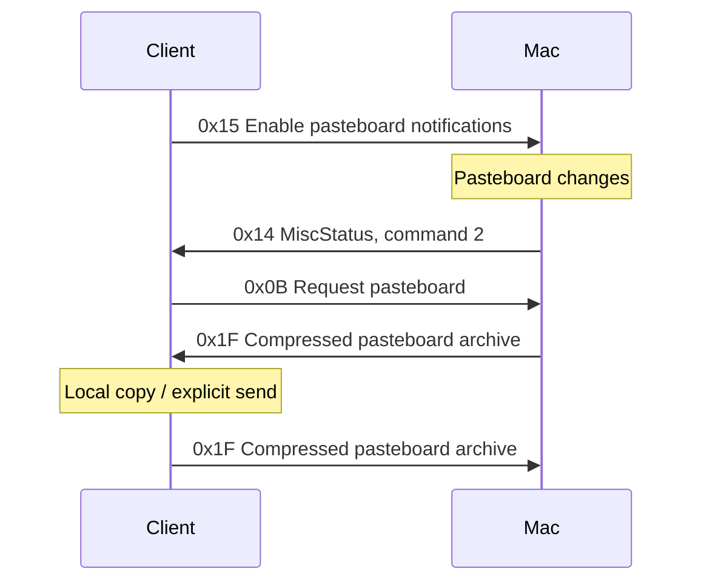

# High Performance Screen Sharing

Apple's High Performance Screen Sharing (HPSS) protocol lets a client access a
Mac using its built-in Screen Sharing service. It extends the Remote Framebuffer
(RFB) protocol with authentication, encrypted control messages, virtual displays
and separate media streams over UDP.

This document describes the part of HPSS understood through the development of
[Vicinia](https://codeberg.org/danielebufarini/vicinia), a native iPhone and iPad
client. It covers Adaptive mode, including HEVC 4:4:4 video, AAC-ELD audio,
remote input and clipboard exchange.

HPSS is not a publicly specified protocol in its entirety. This is an unofficial,
partial description of the wire formats and behavior implemented by Vicinia. It
is not an Apple specification. Some fields are reproduced from interoperable
messages without their full meaning being known.

## Protocol overview

An HPSS session uses a TCP connection for authentication and control, and two UDP
connections for media. The TCP connection stays open while the media streams are
active. Media keys and port numbers are exchanged through the control channel.



| Channel | Transport | Purpose |
| --- | --- | --- |
| Control | TCP, normally port 5900 on the Mac | Authentication, encryption, display configuration, input, cursor, clipboard and media negotiation |
| Video | UDP, negotiated server port | HEVC RTP and RTCP feedback |
| Audio | UDP, negotiated server port | AAC-ELD RTP, keepalive and RTCP |

Vicinia binds local UDP ports 5900 (audio) and 5901 (video). These are the ports
used by its interoperable configuration, not a claim that all clients must use
them. The Mac supplies its own media ports during negotiation.

Unless otherwise stated, integers in the layouts below are big-endian. `u8`,
`u16`, `u32` and `u64` denote unsigned integers of the corresponding width;
`i32` denotes a signed 32-bit integer. Offsets are zero-based, lengths are in
bytes, and hexadecimal values are prefixed with `0x`. Spaces in byte sequences
are for readability. Protocol Buffers use their own standard wire encoding.

## Establishing a session

The following sequence describes the working Adaptive-mode path. A server may
send status messages and several framebuffer rectangles during negotiation;
media port information can arrive before the control encryption switch.



The order of the media answer and the display layout is not significant in this
diagram. Vicinia waits for an authoritative single-display layout matching the
negotiated video canvas before presenting the new stream. Media packets can arrive
before that point.

### Authentication

The server advertises `RFB 003.889\n` (12 bytes). It then sends a one-byte count
followed by that many security type bytes. Vicinia selects security type 33
(`0x21`), an Apple authentication scheme using RSA and SRP-6a. It does not fall
back to another security type.

The initial key request is:

```text
21 00 00 00 0a 01 00 52 53 41 31 00 00 00 00
```

The response begins with `u32 body_length`, followed by a body containing a
two-byte prefix, `u32 der_length` and the DER-encoded SubjectPublicKeyInfo.
The RSA key used by this profile is 2048 bits. Vicinia fingerprints the DER
bytes with SHA-256 and requires explicit trust on first use or a match against
the previously saved fingerprint. A changed key is rejected.

The first client authentication envelope (`c2s1`) is 654 bytes including its
length prefix:

```text
u32 650
01 00 "RSA1" 00 02
u16 256
bytes[256] RSA ciphertext
bytes[384] zero padding
```

The RSA ciphertext uses PKCS#1 v1.5 encryption of the following plaintext:

```text
u32 inner_length
u32 username_length
bytes[username_length] UTF-8 username
00 00 00
```

`inner_length` includes the username length field and the three trailing zero
bytes. The password is not part of this RSA envelope.

The successful server challenge and proof envelopes use the following framing:

```text
u32 total_length
u32 step
u16 x
u32 payload_length
bytes[payload_length] payload
```

`total_length = 10 + payload_length` and `x = payload_length + 4`.
The challenge payload contains:

| Field | Encoding |
| --- | --- |
| Control | `u8`, zero |
| SRP modulus N | `u16 length`, bytes |
| Generator g | `u16 length`, bytes |
| Salt | `u8 length`, bytes |
| Server public value B | `u16 length`, bytes |
| PBKDF2 iteration count | `u64` |
| Options | `u16 length`, bytes; includes `mda=SHA-512` |

The working SRP profile uses the 4096-bit group from RFC 5054 Appendix A, with
generator 5. It uses SHA-512 and a password derivation step based on
PBKDF2-HMAC-SHA512, producing 128 bytes. The SRP identity in the hash formulas
is empty, even though the actual username was sent in the RSA envelope.

Let `H` denote SHA-512, `PAD` denote a 512-byte big-endian representation,
`||` denote concatenation and `a` denote the client's private random value.
The implemented calculations are:

```text
x  = H(salt || H(":" || PBKDF2-HMAC-SHA512(password, salt, iterations, 128)))
k  = H(N || PAD(g))
A  = g^a mod N
u  = H(PAD(A) || B_wire)
S  = (B - k * g^x)^(a + u*x) mod N
K  = H(PAD(S))
M1 = H((H(N) XOR H(PAD(g))) || H(empty) || salt || PAD(A) || B_wire || K)
M2 = H(PAD(A) || M1 || K)
wrap_key = first 16 bytes of SHA-256(K)
```

`B_wire` is the server's public value exactly as received, without additional
padding. Hashes used in modular arithmetic are interpreted as big-endian
integers. The client validates the group, generator and challenge parameters,
and rejects degenerate public values and computations.

The second client envelope (`c2s2`) is 1080 bytes including its length prefix:

```text
u32 1076
01 00 "RSA1" 00 02
u16 (payload_length + 4)
u32 payload_length
u16 512 | bytes[512] PAD(A)
u8 64   | bytes[64] M1
u16 options_length | bytes[options_length] echoed options
u8 16   | bytes[16] client random
zero padding to the declared 1076-byte body length
```

The final successful proof payload starts with `u8 64`, 64 bytes of M2,
`u8 random_length` and the server random bytes. A four-byte RFB SecurityResult
follows the envelope. Both a zero result and a matching M2 are required.
A wrong password on the observed macOS 27.2.1 host produced a short failure
envelope (`total_length = 6`, `u32 step`, `u16 0`) without a server proof.

### Client initialization

After authentication, the client sends `0xC1` as ClientInit. The server replies
with the normal RFB ServerInit structure: width, height, a 16-byte pixel format,
a four-byte name length and the name.

The next message is ViewerInfo (`0x21`, 66 bytes):

```text
u8 0x21 | u8 0 | u16 0x003E | u16 1
u32 viewer_app
u32 app_major | u32 app_minor | u32 app_patch
u32 os_major  | u32 os_minor  | u32 os_patch
bytes[32] capability_bitmap
```

Vicinia identifies itself with `viewer_app = 0x5643`, rather than using the
identity of Apple's viewer. Its capability bitmap has the following nonzero
bytes (all other bytes are zero):

| Offset | Value |
| --- | --- |
| 0 | `0xB0` |
| 2 | `0x0C` |
| 3 | `0x03` |
| 4 | `0x90` |
| 10 | `0x40` |

The meaning of every individual capability bit has not been established.

ViewerInfo is followed by the plaintext encryption-start message:

```text
12 00 00 01 00 01 00 01 00 00 00 01
```

The client requests its virtual display and sends SetEncodings without encoding
1010. Once the server supplies the first encryption key and IV, the client
sends the following plaintext toggle:

```text
12 00 00 02 00 01 00 00
```

All subsequent control messages are carried in encrypted records. The client
sends SetEncodings again, this time including encoding 1010.

## Control encryption

The encryption rectangle has encoding 1103 (`0x44F`) and a fixed 36-byte body:

```text
u32 generation
bytes[16] encrypted_key
bytes[16] encrypted_iv
```

The key and IV are unwrapped separately with AES-128-ECB, using the initial
SRP-derived wrap key. They initialize persistent AES-128-CBC contexts, one per
direction. Both start with the supplied IV. The unwrapped key also becomes the
wrap key used for nested pointer encryption and any later key rotation.

Each encrypted record on TCP is framed as follows:

```text
u16 ciphertext_length
bytes[ciphertext_length] ciphertext
```

The CBC plaintext is:

```text
u16 body_length
bytes[body_length] body
bytes[0..15] filler
bytes[20] SHA-1(u32 sequence || body_length || body || filler)
```

The filler makes the complete plaintext a multiple of 16 bytes; Vicinia uses
random filler. There is no separate PKCS#7 padding. Sequence counters start at
zero independently in each direction and advance once per record, modulo 2^32.
CBC chaining continues across records. The SHA-1 trailer is not an HMAC.

The accepted ciphertext length is 32 to 65,520 bytes, in multiples of 16. This
allows a body of up to 65,498 bytes in one record. An RFB message may span several
records, and a record may contain more than one RFB message. The receiver must
parse the concatenated plaintext by message grammar, not record boundaries.

Vicinia supports later 1103 key rotations by replacing the CBC contexts and wrap
key while retaining sequence counters. This path is covered by local tests, but
its source explicitly states that later rotation has not been exercised in a
capture. It should not be treated as verified host behavior.

The control channel is not TLS, and its cipher and integrity construction should
not be confused with a modern AEAD protocol. Host verification, server-proof
verification and fail-closed record parsing are important for this profile. This
document does not establish its suitability for exposure to the Internet.

## Control messages

The control channel carries ordinary RFB messages and Apple-specific extensions.
Some opcodes have different meanings in different directions or protocol phases.

### Client to Mac

| Type | Message | Layout or purpose |
| --- | --- | --- |
| `0x02` | SetEncodings | `u8 type, u8 pad, u16 count, i32[count] encodings` |
| `0x03` | FramebufferUpdateRequest | `u8 type, u8 incremental, u16 x, y, width, height` |
| `0x04` | KeyEvent | `u8 type, u8 down, u16 pad, u32 keysym` |
| `0x09` | Update rearm | Native update/cursor rearming; followed by a full update request |
| `0x0B` | Pasteboard request | Eight bytes; see Clipboard |
| `0x10` | Encrypted pointer event | Two-byte header and one AES block |
| `0x12` | Encryption control | Plaintext start and toggle during setup |
| `0x15` | Pasteboard monitoring | Eight bytes; see Clipboard |
| `0x1C` | MediaStreamOptions | Adaptive media offer |
| `0x1D` | SetDisplayConfiguration | Virtual display request |
| `0x1F` | Pasteboard data | Compressed pasteboard archive |
| `0x21` | ViewerInfo | Viewer identity and capabilities during setup |

### Mac to client

| Type | Message | Layout or purpose |
| --- | --- | --- |
| `0x00` | FramebufferUpdate | `u8 type, u8 pad, u16 rectangle_count`, then rectangles |
| `0x02` | Bell | One byte |
| `0x03` | ServerCutText | `u8 type, bytes[3] pad, u32 length, bytes[length]` |
| `0x14` | MiscStatus | `u8 type, u8 pad, u16 body_length, body` |
| `0x1F` | Pasteboard data | Compressed pasteboard archive |

The MiscStatus command is the big-endian `u16` at body offset 2, when the body
contains at least four bytes. Command 2 indicates a pasteboard change. Command
4 is handled as a status/heartbeat message.

A framebuffer rectangle starts with a 12-byte header:

```text
u16 x | u16 y | u16 width | u16 height | i32 encoding
```

The encoding determines the length and interpretation of the body.

| Encoding | Body framing | Known use |
| --- | --- | --- |
| 6, 16 | `u32 length`, bytes | zlib / ZRLE pixels; skipped in Adaptive mode |
| -223 | No body | DesktopSize |
| 1002 | `u16 length`, bytes | Delimited metadata |
| 1010 (`0x3F2`) | `u16 length`, bytes | Media stream messages |
| 1011 (`0x3F3`) | `u16 length`, bytes | Delimited metadata |
| 1103 (`0x44F`) | 36 bytes | Encryption key and IV |
| 1104 (`0x450`) | `u32 cache_id, u32 length`, bytes | Cursor shape or cache selection |
| 1105 (`0x451`) | `u16 length`, bytes | Display layout |
| 1107 (`0x453`) | `u16 length`, bytes | Delimited metadata |
| 1109 (`0x455`) | `u16 length`, bytes | Host keyboard status |
| 1110 (`0x456`) | `u16 length`, bytes | Delimited metadata |
| 1100, 1101 | Unknown | Advertised by the client, not received in the documented observations |

Vicinia advertises the following ordered list:

```text
1010, 1011, 1002, 6, 16, 1104, 1100, -223, 1101, 1105, 1107, 1109, 1110
```

A known-length message can be skipped when its contents are not needed. A message
or rectangle without known framing cannot be safely skipped; Vicinia closes the
session rather than guessing where the next message starts.

## Virtual displays

The client requests a dynamic virtual display using SetDisplayConfiguration
(`0x1D`). The following is the interoperable single-display configuration used
by Vicinia, not a complete schema for all display types:

```text
u8 0x1D | u8 0 | u16 (8 + descriptor_length)
u16 1 | u16 1 | u32 0
bytes[descriptor_length] descriptor
```

The descriptor contains a fixed header followed by five 28-byte mode entries.
The descriptor length is `0x9C + 28 * mode_count`.

| Descriptor offset | Format | Value or meaning |
| --- | --- | --- |
| `0x00` | `u16` | Descriptor length |
| `0x02` | bytes | UTF-8 name, zero-filled field (up to 119 bytes of name) |
| `0x7A` | `u32` | Dynamic resolution flag, 1 |
| `0x7E` | `u32` | Virtual display type, 4 |
| `0x82`, `0x86` | float32 | Physical width and height in mm (369.45456, 207.81818 in this profile) |
| `0x8A`, `0x8E` | `u32` | Maximum backing dimensions, 3840 × 2160 |
| `0x92`, `0x94` | `u16` | Zero in this profile |
| `0x96` | `u32` | 7; full meaning unknown |
| `0x9A` | `u16` | Number of mode entries |
| `0x9C` | entries | Mode table |

Each mode contains four `u32` dimensions (backing width, backing height, logical
width, logical height), a big-endian IEEE 754 float64 refresh rate and a `u32`
flags field. Vicinia requests 60 Hz with zero mode flags, and builds its five modes
by scaling the logical templates `(1920,1080)`, `(1440,900)`, `(1920,1080)`,
`(1440,810)` and `(1312,848)` to the target dimensions. Backing dimensions are
then derived using the requested HiDPI scale.

The host reports the actual layout in encoding 1105. Its body has a 20-byte
header followed by 56-byte display entries:

| Body offset | Format | Meaning |
| --- | --- | --- |
| 2, 4 | `u16` | Scaled canvas width, height |
| 6, 8 | `u16` | Backing canvas width, height |
| 18 | `u16` | Display count |
| `20 + 56*i + 20` | four `u16` | Logical rectangle of display i |
| `20 + 56*i + 28` | four `u16` | Backing rectangle of display i |

The rectangles are stored as `y0, x0, y1, x1`, with the end coordinates exclusive.
Other layout fields are not interpreted here. The reported layout, rather than
the requested resolution, is authoritative for input and presentation.

On each layout notification, including one with unchanged geometry, the working
client rearms native updates with:

```text
09 00 00 01 ff ff ff ff
u16 0 | u16 0 | u16 scaled_width | u16 scaled_height
```

It follows this with a non-incremental framebuffer update request covering
`0, 0, 0xFFFF, 0xFFFF`. A layout notification alone does not initiate a media
offer. A fresh media message 1 is needed to negotiate another media stream.

## Media negotiation

Encoding 1010 carries media stream messages from the Mac. The first two bytes of
the body are the message kind:

| Kind | Meaning | Known fields |
| --- | --- | --- |
| 1 | Media initialization | `u16` audio, video and second-video ports at offsets 8, 14 and 20; body at least 24 bytes |
| 2 | Media answer | Three `u16` blob lengths at offsets 8, 10 and 12; blobs from offset 18, in audio/video/second-video order |
| 3 | Media error | Two `u32` values (error type and sub-code) at offsets 8 and 12 |

The Mac announces the ports before the client sends MediaStreamOptions (`0x1C`).
The offer contains the media descriptions and the SRTP master key material. It
is sent through the encrypted control channel, followed by a non-incremental
framebuffer update request.

### MediaStreamOptions

Let `a` and `v` be the lengths of the audio and video binary property lists,
and let `p = 0x80 + a`. The message has the following layout:

| Offset | Size | Value or meaning |
| --- | ---: | --- |
| `0x00` | 1 | `0x1C` |
| `0x01` | 1 | Zero |
| `0x02` | 2 | `a + v + 0xD8` (body length) |
| `0x04` | 2 | Version/value 3 |
| `0x06` | 4 | Configuration flags, `0x05` |
| `0x0A` | 2 | `a` |
| `0x0C` | 2 | `v` |
| `0x0E` | 6 | Zero |
| `0x14` | 16 | Call identifier bytes |
| `0x24` | 46 | Audio key and salt, client to Mac |
| `0x52` | 46 | Audio key and salt, Mac to client |
| `0x80` | a | Audio property list |
| p | 46 | Video key and salt, client to Mac |
| p + 46 | 46 | Video key and salt, Mac to client |
| p + 92 | v | Video property list |

The complete message is `a + v + 0xDC` bytes. Configuration bit 0 requests the
60 fps first video stream, bit 1 enables the second video stream when set, and
bit 2 suppresses the cursor in the video. Vicinia uses bits 0 and 2, and leaves
the second video stream disabled.

Each property list contains:

| Key | Value |
| --- | --- |
| `avcMediaStreamOptionRemoteEndpointInfo` | Protobuf-encoded endpoint description |
| `avcMediaStreamNegotiatorMode` | 7 for video, 8 for audio |
| `avcMediaStreamNegotiatorMediaBlob` | zlib-compressed protobuf |
| `avcMediaStreamOptionCallID` | Uppercase UUID string |

The endpoint description has varint fields 1 and 2 set to 0 and 1, and string
fields 3, 4 and 5 containing the hardware model, `1.0.0` and OS build string in
the working profile.

### MediaBlob

Only part of the protobuf schema is understood. The following tables describe
the emitted values. Fields with no established semantics are listed as values,
not assigned speculative names. All numeric entries are varints unless indicated
otherwise.

| Top-level field | Value |
| --- | --- |
| 1, 2 | 1, 1 |
| 3 | Audio description (length-delimited, audio offer only) |
| 5 | Video description (length-delimited, video offer only) |
| 6 | Client name (UTF-8) |
| 8 | 0 |
| 9 | Repeated bitrate-tier entries (length-delimited) |
| 13 | Unix timestamp in nanoseconds |
| 14, 16, 18 | 2, 0, 1 |

The video description uses field 1 for the viewer's video SSRC, field 2 set to
1, field 3 for the codec bank, field 6 for the number of tiles (4), and fields
7, 8, 9 and 12 set to 1, 63, 1 and 1 respectively.

The codec bank that yields HEVC 4:4:4 in the observed profile contains:

- Field 1: 100.
- Field 2: two nested entries with fields `(1, 2, 3, 4)` set to
  `(1, 1, 50115, 0)` and `(1, 2, 50115, 0)`.
- Field 3: the UTF-8 parameter string below.
- Field 4: 14.

```text
FLS;LF:-1;POS:5;EOD:1;HTS:2;RR:3;POSE:4;AR:16/9,5/8;XR:16/9,5/8;
```

The individual tokens in this string are not fully understood. The bank was
selected because it produces the required HEVC profile, not on the basis of a
complete codec negotiation specification.

The audio description uses field 1 for the viewer's audio SSRC, fields 2 and 3
set to zero, field 4 for the requested bitrate, and fields 5 and 6 set to zero.
The top-level bitrate entries (field 9) are preserved in the following order;
columns correspond to nested fields 1, 2 and 3. A dash means the field is absent.

| Field 1 | Field 2 | Field 3 |
| ---: | ---: | ---: |
| 0 | 40000000 | 12288 |
| 0 | 6000000 | 131072 |
| 4074 | 0 | 16384 |
| 16 | 4100 | — |
| 0 | 75000000 | 524288 |
| 0 | 20000000 | 98304 |
| 4 | 6500 | — |
| 0 | 60000000 | 262144 |
| 1 | 299 | — |
| 0 | 100000000 | 1048576 |

The answer supplies the negotiated media descriptions. In the video description
(top-level field 5), fields 4, 5 and 6 contain the canvas width, height and tile
count respectively, and field 7 indicates long-term reference picture (LTRP)
support. The LTRP flag must be read from the first video answer blob, not from the
audio or second-video blob. The video answer can contain a binary property list
or a bare zlib-compressed negotiator blob.

## Media transport

Each media direction uses its own 46-byte master key and salt: 32 bytes of key
and 14 bytes of salt. The interoperable SRTP and SRTCP profile uses AES-256-ICM
with HMAC-SHA1-80. Vicinia creates four independent libSRTP contexts (audio and
video, inbound and outbound) and uses a per-SSRC replay window of 1024 packets.

The media RTP header follows RFC 3550, including the usual sequence number,
timestamp, SSRC, marker, CSRC list, extension and padding fields. RTCP is
multiplexed with RTP on the UDP legs; the receiver uses the RTP/RTCP packet-type
range 192–223 in the second byte to distinguish RTCP. Authentication and replay
checks precede media processing.

A fresh offer carries fresh key material and viewer SSRCs. It starts a new media
generation, so packets and feedback state from the previous offer must not be
mixed with the new stream. The TCP connection can remain open across display
reconfiguration.

### Video

Video uses RTP payload type 100. The working Adaptive profile divides the canvas
into four horizontal stripes, each with its own SSRC. The stripe SSRCs form a
consecutive group; Vicinia identifies the group from received packets, using the
lowest SSRC in the selected run as stripe zero. The group can change across
offers. The viewer's own video SSRC is separate from these host SSRCs.

Stripes belonging to one desktop update have the same RTP timestamp. Partial
updates are valid: a timestamp does not necessarily carry all four stripes.
Unchanged stripes retain their last valid image. The video timing used for rate
control is 24 kHz, rather than the conventional 90 kHz used for many RTP video
formats.



HPSS uses HEVC RTP packetization similar to RFC 7798, with differences in the
placement of the decoding order number (DONL). The following payload layouts are
used after SRTP decryption. The two-byte NAL header is the ordinary HEVC header.

| Packet | RTP payload layout |
| --- | --- |
| Single NAL | `NAL header[2]`, `u16 DONL`, NAL body |
| Aggregation packet (type 48) | `NAL header[2]`, `u16 DONL`, repeated `u16 NAL_length, NAL[NAL_length]` |
| Fragmentation unit (type 49) | `NAL header[2]`, `u8 FU_header`, `u16 DONL`, fragment bytes |

Aggregation packets do not contain DOND bytes between aggregated NAL units in
this profile. Every fragmentation unit, including continuation fragments,
contains a DONL. For the FU header, bit 7 is the start flag, bit 6 is the end
flag, and the low six bits encode the original NAL unit type. To rebuild the
original NAL header, replace the six type bits of the payload header with that
original type; retain the other header bits. Strip the DONL before passing the
NAL unit to the decoder.

An RTP marker closes an access unit for one stripe, subject to packet sequence
continuity and complete NAL reconstruction. DONL is a 16-bit counter shared
across the stripe SSRCs. Observations show it advances by one for each picture,
in timestamp and stripe order, with no number consumed for an absent stripe.
A decoder must therefore receive access units in global DONL order, not simply
the order in which their RTP groups finish assembling. This matters because
the stripes share one decoder and decoded picture buffer (DPB).

For HEVC 4:4:4, the SPS reports `chroma_format_idc = 3`. The decoder should also
honor the coded dimensions and SPS conformance window. Vicinia uses visible
stripe heights when the SPS contains a conformance window, otherwise stacking
coded heights and clipping at the canvas bottom. That is a rendering rule for
its observed streams, not a separate HPSS wire field.

When a compressed picture is irrecoverably lost, Vicinia requests a fresh
random-access picture and does not decode dependent pictures until the stream
is realigned. The IRAP NAL types used by its recovery path are 16 through 21.

### Audio

Audio uses RTP payload type 101. Each packet contains one raw MPEG-4 AAC-ELD
access unit, without RFC 3640 AU headers. The observed format is:

| Property | Value |
| --- | --- |
| Codec | AAC Enhanced Low Delay with SBR |
| Sample rate | 48,000 Hz |
| Channels | 2 |
| Samples per channel per access unit | 480 |
| Packet duration | 10 ms |
| AudioSpecificConfig | `f8 e6 51 32 e0 00` |

The access units do not need ADTS headers. Silence can arrive as ordinary
four-byte access units. The 480-sample framing matters when setting up a decoder.

Audio is requested in the offer using field 4 of the audio description. The
value 24,191 requests the native audio bitrate configuration; the host chooses
an AAC-ELD tier. A value of 1,000 is below the lowest tier floor in the observed
configuration and suppresses host audio. The audio section remains present in
the offer in either case. No native in-session audio enable/disable command has
been established by this implementation. Local mute does not imply a protocol
command to stop host audio.

### Media feedback

Both media legs carry protected RTCP. The working receiver sends the following
feedback; intervals are those implemented by Vicinia rather than independently
established protocol timing requirements.

| Message | Leg | Interval or trigger |
| --- | --- | --- |
| RTP keepalive, PT 101 | Audio | Every 500 ms |
| RTCP RR, PT 201 | Video | Every 500 ms, one report block per stripe |
| Empty RTCP SR, PT 200 | Video | Every 5 seconds, with RR |
| RTCP RR, PT 201 | Audio | About once per second |
| RTCP APP `RCTL`, PT 204 | Video | Every 50 ms once video timestamps are available |
| RTCP APP LTRP acknowledgment, PT 204 | Video | When negotiated and an eligible picture is available |
| RR + FIR + PLI + legacy FIR | Video | Recovery after irrecoverable loss; rate-limited |

The outgoing audio keepalive has RTP payload `00 68 34 00`, its own viewer
SSRC, a sequence number incremented by one and a timestamp incremented by 480
for each keepalive. It is sent even when incoming audio is suppressed.

Receiver reports include the extended sequence number, the middle 32 bits of the
last sender-report NTP timestamp (LSR) and the delay since that report (DLSR).
RTCP sender reports correlate the audio and video RTP clocks to NTP time. This
allows the receiver to align playback without assuming that the two RTP clocks
share the same origin. Host video sender reports are observed on stripe zero.

#### Rate control

The `RCTL` message is a standalone RTCP APP packet of 32 bytes before SRTCP
protection. The following is the format emitted by Vicinia:

| Offset | Format | Value or meaning |
| --- | --- | --- |
| 0 | `u8` | `0x80` (RTCP version 2, subtype 0) |
| 1 | `u8` | 204 (APP) |
| 2 | `u16` | 7 (length in 32-bit words minus one) |
| 4 | `u32` | Viewer's video SSRC |
| 8 | bytes[4] | ASCII `RCTL` |
| 12 | `u8` | `0x85` |
| 13 | `u8` | 0 |
| 14 | `u16` | 4 |
| 16 | `u16` | `(last_rtp_timestamp >> 8) & 0xFFFF` |
| 18 | `u32` | 0 |
| 22 | `u16` | Hold time in milliseconds |
| 24 | `u16` | Local clock in 1/1024-second units, modulo 65536 |
| 26 | `u16` | Estimated relative delay in 1/8192-second units |
| 28 | `u16` | Received packet count modulo 4096 |
| 30 | `u16` | Bandwidth in kbit/s (60,000 in Vicinia) |

The relative delay estimator compares elapsed arrival time with elapsed RTP
clock time, using stripe-zero pictures and a 24 kHz clock. It compares short
and long moving averages to estimate queueing delay, rather than absolute
one-way network latency. The host's internal rate-control algorithm is unknown.

#### Long-term reference picture acknowledgments

When the first video answer enables LTRP (protobuf field 5.7 is nonzero) and the
stream uses HEVC, the client sends a dedicated reference acknowledgment. This is
not a receiver report, a picture-loss indication or an acknowledgment of every
RTP packet.

The acknowledgment is a standalone, 16-byte RTCP APP packet:

| Offset | Format | Value or meaning |
| --- | --- | --- |
| 0 | `u8` | `0x80` |
| 1 | `u8` | 204 (`0xCC`, APP) |
| 2 | `u16` | 3 |
| 4 | `u32` | Viewer's video SSRC |
| 8 | `u32` | 5 (numeric value in the APP name slot) |
| 12 | `u32` | Confirmed 16-bit DONL, zero-extended |

For example, with viewer SSRC `0x57205E90` and DONL `0x1234`, the plaintext
packet is:

```text
80 cc 00 03 57 20 5e 90 00 00 00 05 00 00 12 34
```

The client sends it on the video UDP leg after SRTCP protection. Vicinia confirms
the newest stripe-zero access unit handed to the decoder in decode order, after
random access has been established. It sends at most one confirmation per
processing batch. It does not wait for display presentation, and it does not
confirm units withheld from the decoder. A pending confirmation is discarded
on loss, reset or a return to waiting for random access.

The acknowledgment is inactive when the video flag is absent, disabled or
unparseable, or when a new offer has not yet been accepted. This behavior avoids
assuming LTRP support from the client's own offer. The precise host-side
reference selection and quality-control algorithms remain unknown.

## Remote input and cursor

Keyboard input uses the ordinary eight-byte RFB KeyEvent:

```text
04 | u8 down | u16 0 | u32 keysym
```

Pointer input uses an additional Apple wrapper even after control encryption has
been enabled. The inner block is encrypted using AES-128-ECB with the current
unwrapped record key:

```text
00 00 00 00 00 00 00 00 00 00 ff
u8 buttons | u16 x | u16 y
```

The 18-byte outer message is:

```text
10 00 | bytes[16] encrypted_pointer_block
```

Apple's button mask orders the first three bits as left, right, middle. A normal
RFB mask orders them as left, middle, right. Bits 1 and 2 therefore need to be
exchanged when translating a standard RFB mask. The wire coordinates are host
backing coordinates, not the client's view coordinates or the host's logical
point coordinates. Wheel events are represented by pointer-button pulses.

### Cursor shapes

With the cursor excluded from the video, the server supplies cursor shapes in
encoding 1104. The rectangle header's `x` and `y` are the hotspot and its width
and height are the cursor dimensions. The body is:

```text
u32 cache_id | u32 compressed_length | bytes[compressed_length]
```

A zero compressed length selects a cached cursor by ID. A nonzero length stores
and selects a new cursor. For a cursor of width `w` and height `h`, the zlib
payload expands to `5*w*h` bytes: four bytes per pixel in BGRA order followed
by a separate `w*h` byte alpha plane. The latter replaces the alpha byte in
each BGRA pixel.

Encoding 1109 contains the host keyboard status:

```text
u16 version (1) | u32 flags | u16 source_length | UTF-8 source
```

Bit 0 of the flags indicates secure keyboard input. Other flag meanings have
not been established here.

## Clipboard

HPSS has a pasteboard exchange mechanism distinct from ordinary RFB
ServerCutText. It can carry multiple items and multiple representations of each
item, including text, URLs, rich text and images.

The client enables automatic pasteboard notifications with:

```text
15 00 00 01 00 00 00 00
```

The Mac signals a pasteboard change through MiscStatus command 2. The client
requests its contents with:

```text
0b 00 00 00 00 00 00 00
```

Clipboard data travels as message `0x1F` in either direction. In the observed
Apple Screen Sharing exchange with the all-zero request above, the reply has
no echoed request identifier. Whether the other request bytes can be used to
obtain a correlated reply remains unresolved.

Vicinia serializes its clipboard writes, suppresses an abandoned fetch before
handing its request to the session writer, and checks local and remote
freshness before applying an answer. Once a request has been dispatched, its
late reply can be indistinguishable from the reply to a newer request. These
client checks do not add correlation or cancellation to the wire protocol.



The data message starts with a 16-byte header:

| Offset | Format | Meaning |
| --- | --- | --- |
| 0 | `u8` | `0x1F` |
| 1 | `u8` | Zero in the emitted message |
| 2 | `u8` | Bit 0: promise flag |
| 3 | `u8` | Zero in the emitted message |
| 4 | `u32` | Zero in the emitted message |
| 8 | `u32` | Uncompressed archive length |
| 12 | `u32` | Compressed archive length |
| 16 | bytes | Compressed archive |

The compression format is zlib. A native message can end at a `Z_SYNC_FLUSH`
marker (`00 00 ff ff`) without a final deflate block or Adler-32 trailer. A
receiver must accept this form and check that inflation produces exactly the
declared uncompressed size. Vicinia also accepts complete zlib streams.

The archive is a sequence of items, with no outer item count. Items are read
until the declared uncompressed archive ends:

```text
item:
    u32 flavor_count
    flavor[flavor_count]

flavor:
    u32 type_length | bytes[type_length] UTF-8 type identifier
    u32 reserved
    u32 tag_count
    tag[tag_count]
    u32 data_length | bytes[data_length] data

tag:
    u32 name_length | bytes[name_length] name
    u32 value_length | bytes[value_length] value
```

Type identifiers are Apple's pasteboard type identifiers (for example,
`public.utf8-plain-text`, `public.utf16-plain-text`, `public.url` and
`public.png`). UTF-16 plain text on the wire is big-endian; Vicinia swaps the
byte pairs when translating to and from its local representation.

Vicinia sends full data, with the promise flag, reserved field and tag count
set to zero. It understands the framing of tags and promises but does not
implement promised-file retrieval. Its supported content includes UTF-8 text,
UTF-16 text fallback, URLs, RTF, HTML, PNG, JPEG, TIFF, HEIC and GIF. This is a
client content policy, not a complete list of types supported by HPSS.

Clipboard messages can cross record boundaries. The parser treats a compressed
length above 100 MiB as invalid for the observed native framing. Vicinia applies
stricter engineering bounds (4 MiB buffered compressed input and 16 MiB inflated
archive, among other item and representation limits). A message over the client
buffer limit but within the native framing limit is discarded without buffering
its entire payload. These bounds are not advertised protocol capabilities.

## What is not covered

This document describes one interoperable Adaptive-mode configuration. It does
not define every mode or message understood by Apple's Screen Sharing service.
In particular, it does not establish:

- The complete ViewerInfo capability bitmap, codec-bank parameter grammar,
  media protobuf schema or error-code registry.
- The payload grammar of encodings 1100 and 1101, or the full semantics of
  the metadata encodings that Vicinia only delimits.
- Second-video, multiple-display, HDR or other HPSS modes.
- File transfer, drag-and-drop or fulfillment of pasteboard promises.
- Full Unicode keyboard input, IME composition or all login-window transitions.
- Host encoder internals, all reference-picture modes or later control-channel
  key rotation behavior on a real host.
- Compatibility with every macOS release or the security properties of all
  possible HPSS profiles.

## References and verification

The description is based on the protocol and media implementation in Vicinia,
its regression tests and the observations recorded in their comments. The
source snapshot includes HEVC LTRP, AAC-ELD and clipboard code; implementation
coverage does not by itself establish release availability or full physical
interoperability for every feature.

The relevant source files are under `Vicinia/Session/`, `Vicinia/Media/` and
`Vicinia/Input/`. The tests under `ViciniaTests/` include fixed wire vectors,
synthetic messages, encrypted records, media fixtures and simulated host
exchanges. Useful starting points are:

| Area | Implementation | Tests |
| --- | --- | --- |
| Authentication | `HPSSAuthenticator.swift`, `SRPClient.swift`, `HostIdentity.swift` | `AuthenticationTests.swift`, `OracleVectors.swift` |
| Control and record framing | `HPSSSession.swift`, `RecordLayer.swift`, `RFBMessages.swift` | `TransportSecurityTests.swift`, `SessionControlTests.swift` |
| Display and input | `RFBMessages.swift`, `DisplayGeometry.swift`, `InputState.swift`, `Cursor.swift` | `DisplayTests.swift`, `InputTests.swift`, `MediaPathTests.swift` |
| Media negotiation and HEVC | `MediaOffer.swift`, `HEVCAssembler.swift`, `MediaTransport.swift`, `MediaPipeline.swift` | `MediaPathTests.swift`, `RecoveryTests.swift`, `HEVC444Fixture.swift` |
| LTRP and rate control | `ReferenceAcknowledgment.swift`, `MediaFeedback.swift` | `ReferenceAcknowledgmentTests.swift`, `TransportSecurityTests.swift` |
| Audio | `AudioStream.swift`, `AudioPipeline.swift`, `AVClockCorrelator.swift` | `AudioTests.swift`, `AVClockCorrelatorTests.swift` |
| Clipboard | `ClipboardWire.swift`, `ClipboardFormats.swift`, `ClipboardBridge.swift` | `ClipboardWireTests.swift`, `ClipboardFormatsTests.swift`, `ClipboardSessionTests.swift` |

Vicinia builds on prior reverse-engineering work in iShareScreen and
open-screen-sharing. The source also credits the remotex rate-control notes for
the RCTL layout. In particular, iShareScreen's `docs/apple_vnc_rfc.md` and
`proxy/media/aac_eld.py` are cited in the audio implementation, and the clipboard
implementation identifies the compatible zlib flush behavior of both projects.
These references are part of the provenance of the protocol knowledge; it is
not all original to Vicinia. Third-party source code remains subject to its
respective license.

Related public standards:

- [RFC 6143](https://www.rfc-editor.org/rfc/rfc6143) — Remote Framebuffer Protocol.
- [RFC 5054](https://www.rfc-editor.org/rfc/rfc5054) — SRP groups and parameters.
- [RFC 3550](https://www.rfc-editor.org/rfc/rfc3550) — RTP and RTCP.
- [RFC 3711](https://www.rfc-editor.org/rfc/rfc3711) and [RFC 6188](https://www.rfc-editor.org/rfc/rfc6188) — SRTP and AES-256 counter-mode suites.
- [RFC 5761](https://www.rfc-editor.org/rfc/rfc5761) — RTP/RTCP multiplexing.
- [RFC 7798](https://www.rfc-editor.org/rfc/rfc7798) — HEVC RTP payload format.
- [RFC 3640](https://www.rfc-editor.org/rfc/rfc3640) — MPEG-4 RTP payload format (the HPSS audio profile described above does not use its AU headers).
- [ITU-T H.265](https://www.itu.int/rec/T-REC-H.265) — HEVC bitstream syntax.

The standards describe the underlying building blocks. Apple's extensions and
its deviations from those standards are described separately above.
