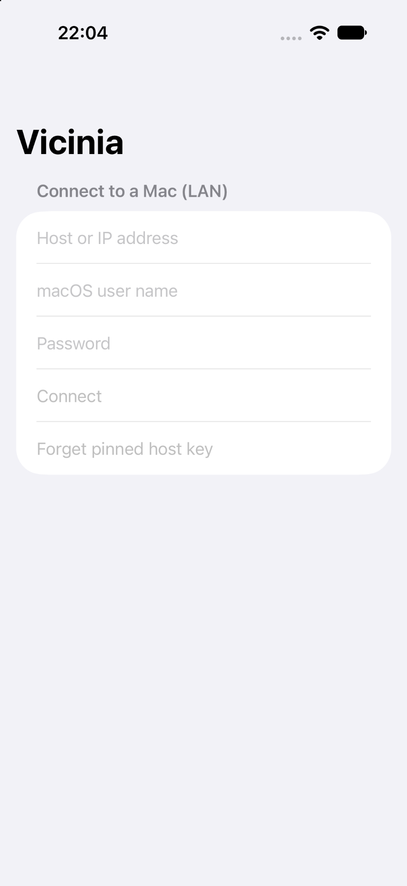
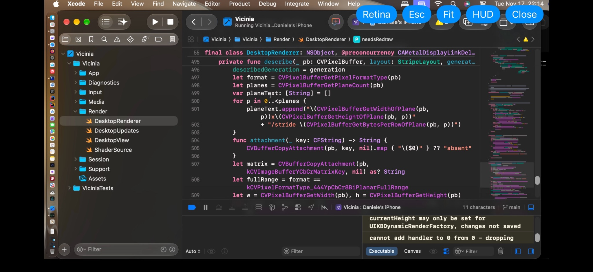

# Vicinia 1.0 — User Manual

**Application version:** 1.0  
**Platforms:** iPhone and iPad  
**Language:** English

Vicinia lets you view and control your Mac from an iPhone or iPad on your local network. It uses Apple's native High Performance Screen Sharing (HPSS) service, so you do not need to install a separate Vicinia server on your Mac.

With Vicinia, you can open applications, browse files in Finder, interact with websites, edit documents and use your Mac's desktop while away from your desk.

## Contents

- [1. System requirements](#1-system-requirements)
- [2. Prepare your Mac](#2-prepare-your-mac)
- [3. Connect to your Mac](#3-connect-to-your-mac)
- [4. Session controls](#4-session-controls)
- [5. Control the Mac with touch gestures](#5-control-the-mac-with-touch-gestures)
- [6. Adjust the remote display](#6-adjust-the-remote-display)
- [7. Use the keyboard](#7-use-the-keyboard)
- [8. Use a mouse, trackpad or Apple Pencil](#8-use-a-mouse-trackpad-or-apple-pencil)
- [9. End or resume a session](#9-end-or-resume-a-session)
- [10. Security and privacy](#10-security-and-privacy)
- [11. Troubleshooting](#11-troubleshooting)
- [12. Frequently asked questions](#12-frequently-asked-questions)
- [13. Current limitations](#13-current-limitations)

## 1. System requirements

### iPhone or iPad

| Device | Target configuration |
| --- | --- |
| iPhone | A19 Pro or later, with iOS 27 or later |
| iPad | iPad Pro with M5 or later, with iPadOS 27 or later |

Vicinia is a universal application designed for both iPhone and iPad. Version 1.0 has been tested on a physical iPhone Air with A19 Pro. Physical iPad and accessory compatibility has not yet been fully verified. Support for every device, keyboard layout or accessory combination is not guaranteed.

A physical keyboard and a mouse or trackpad are optional, but recommended for extended work, particularly for tasks that require keyboard shortcuts.

### Mac

You need:

- An Apple silicon Mac that supports High Performance Screen Sharing.
- macOS 27 or later.
- The built-in **Screen Sharing** service enabled.
- A macOS user account with permission to access Screen Sharing and its password.

### Network

Your iPhone or iPad and Mac must be able to communicate over a trusted local network. The Mac can use Ethernet or Wi-Fi, while the iPhone or iPad normally uses Wi-Fi.

Use the Mac's local IPv4 address for the most reliable connection. Version 1.0 is intended for local network use; direct access over the public Internet is not supported.

## 2. Prepare your Mac

Complete this configuration on your Mac before opening Vicinia for the first time.

### 2.1 Enable Screen Sharing

1. On your Mac, open the Apple menu () and select **System Settings**.
2. Select **General → Sharing**.
3. If **Remote Management** is enabled, turn it off before enabling Screen Sharing. macOS does not allow both services to be enabled together.
4. Open the information button (ⓘ) beside **Screen Sharing** and turn on the service.
5. Under **Allow access for**, select **Only these users** and add the macOS account you intend to use with Vicinia. This is preferable to allowing all users.
6. Select **Done**.

Vicinia uses your macOS account credentials. You do not need to enable the separate option **VNC viewers may control screen with password**, and you do not need to enable permission requests from other users.

If your Mac is managed by an organization, some sharing settings may be restricted. Contact its administrator if you cannot enable Screen Sharing.

For additional information, see Apple's [Turn Mac screen sharing on or off](https://support.apple.com/en-au/guide/mac-help/mh11848/mac) guide.

### 2.2 Find your Mac's address

1. On your Mac, open **System Settings → Network**.
2. Select the active Wi-Fi or Ethernet connection.
3. Open its details and locate the IP address (typically under **TCP/IP**).
4. Make a note of the local IPv4 address.

A typical local address looks like `192.168.1.25` or `10.0.0.15`. These are examples only; enter your own Mac's address in Vicinia.

Your router may assign a different address after a restart or network change. If this happens, use the new address. You may also configure a DHCP reservation on your router to keep the address stable.

### 2.3 Identify your macOS account

Use the user name of the authorized macOS account, preferably its short account name rather than its display name or Apple Account email address.

If you are unsure of the short name, open Terminal on the Mac while logged in to that account and enter:

```sh
whoami
```

The command displays the account name. Use the password you normally use to log in to that Mac account.

### 2.4 Keep the Mac available

Ensure the Mac is powered on, awake and connected to the network. A sleeping or disconnected Mac may be unreachable. For extended remote use, configure its energy or battery settings appropriately. Vicinia 1.0 does not provide a dedicated Wake-on-LAN feature.

## 3. Connect to your Mac

### 3.1 Open Vicinia

Launch Vicinia on your iPhone or iPad. On iPhone, the home screen contains a section titled **Connect to a Mac (LAN)**. On iPad, the same connection controls appear in a centered module.



*Figure 1 — The login screen before entering connection details.*

| Field or button | Purpose |
| --- | --- |
| **Host or IP address** | The Mac's local network address. Use IPv4 for the verified connection configuration. |
| **macOS user name** | The name of the authorized account on the Mac. |
| **Password** | The password of that macOS account. |
| **Connect** | Starts a remote desktop session. |
| **Forget pinned host key** | Removes the saved identity fingerprint for the address currently entered. See [section 10](#10-security-and-privacy). |

Enter all three fields. The **Connect** button is enabled only when none is empty.

Tap **Connect**. If iOS or iPadOS asks for permission to access the local network, allow it.

Vicinia remembers the last host address and user name you entered when connecting. It does not save your password for subsequent logins, so you need to enter it again for each new connection.

### 3.2 Verify the Mac's identity

The first time you connect to a particular host address, Vicinia displays a dialog titled **Verify this Mac**. It shows a SHA-256 fingerprint representing the Mac's RSA identity key.

1. Obtain the expected fingerprint independently from the Mac or its administrator through a trusted channel.
2. Compare the entire fingerprint shown by Vicinia with the expected fingerprint. Do not rely on just its first or last characters.
3. If the fingerprints match, tap **Trust and Pin**.
4. If they differ, or you cannot establish that the connection is trustworthy, tap **Cancel**.

Vicinia does not provide a separate host-side fingerprint retrieval utility in version 1.0. If you own the Mac and choose to accept a fingerprint without independently comparing it, you are using *trust on first use* (TOFU). This remembers the identity presented during the first connection but does not independently authenticate it. Only consider this on a network you control and trust.

Once accepted, the fingerprint is saved on the current iPhone or iPad for the host address you entered. Subsequent connections to that address are checked against the saved fingerprint. If the key changes, Vicinia refuses the connection rather than silently trusting the new identity.

### 3.3 Start using the remote desktop

After successful authentication and display negotiation, the Mac's desktop appears full screen. Vicinia requests landscape orientation at startup, which is usually the most convenient layout for remote desktop work.

You can now open applications and interact with the Mac. A virtual display is negotiated for the session, so its resolution and layout may differ from those of a physical monitor attached to your Mac.

The initial session uses **Retina** display mode and **Trackpad** input mode. The on-screen keyboard is initially hidden. The session toolbar appears together with the desktop and hides automatically after five seconds; see [section 4](#4-session-controls).

## 4. Session controls

During a session, Vicinia shows the Mac's desktop full screen without permanent controls. The session toolbar floats in the upper-right corner only when you need it. When it is hidden, nothing of it remains on screen: the whole display belongs to the remote desktop, and no static Vicinia element stays on screen for long periods, which reduces the risk of image persistence on OLED displays.



*Figure 2 — An active remote desktop session with the session toolbar shown in the upper-right corner. This screenshot was taken with a diagnostic build, which adds a HUD button, and predates the current Liquid Glass toolbar appearance.*

### 4.1 Show and hide the toolbar

| To show or hide the toolbar | Do this |
| --- | --- |
| With touch | Double-tap anywhere on the desktop with two fingers. |
| With VoiceOver or Switch Control | Use the actions described in [section 4.5](#45-accessibility). |

With a mouse or trackpad, show the toolbar with the two-finger double tap on the screen, then click its controls: see [section 8.1](#81-physical-mouse-or-trackpad). Vicinia 1.0 has no keyboard shortcut for the toolbar.

The toolbar behaves as follows:

- When the remote desktop first appears, the toolbar is shown and then hides after five seconds without use.
- Each time you show it, or use one of its controls, it stays for another five seconds.
- It stays visible while you are pressing one of its controls, even for longer than five seconds, and while the session menu is open. The five seconds start again when you release the control.
- It hides as soon as you work on the Mac: click, tap, press and drag, scroll or type. That action still reaches the Mac as usual. Moving the pointer, and pressing a modifier key on its own, does not hide it.
- While Vicinia is connecting, and after a session has ended, the toolbar stays visible so that **Close** is always available.
- Showing or hiding the toolbar never changes the remote display, its resolution, the local zoom or the pointer position.

The two-finger double tap is handled by Vicinia and is never sent to the Mac. Every key you press, including **⌘⇧T**, is sent to the Mac as usual.

The first time you connect to a Mac, a short hint appears near the bottom of the screen:

> **Double-tap with two fingers**
> Show or hide the session toolbar at any time.

It disappears on its own after a few seconds, does not block the desktop, and is not shown again on later connections or after restarting the app.

### 4.2 Toolbar controls

| Control | Function |
| --- | --- |
| **Retina** / **More Space** | Opens the session menu. The button shows the current display mode. |
| **Esc** | Sends the Escape key to the remote Mac. |
| **Fit** | Resets local zoom and pan to show the complete remote desktop within the available viewport. |
| **Close** | Ends the connection and returns to the home screen. |

### 4.3 Session menu

Show the toolbar if it is hidden, then tap the button labelled **Retina** or **More Space** to access these options:

| Option | Function |
| --- | --- |
| **Retina** | Requests a high-density remote display with larger, more readable interface elements. |
| **More Space** | Requests a remote display with more usable desktop space and smaller interface elements. |
| **Local pan (one finger)** | Allows you to reposition the zoomed desktop instead of controlling the Mac with pointing gestures. |
| **Input → Trackpad** | Uses finger movements to move the remote pointer relatively, like a trackpad. |
| **Input → Direct** | Maps touch positions directly to positions on the remote desktop. |
| **Keyboard** | Shows or hides the on-screen keyboard. |

### 4.4 Status overlay (diagnostic builds only)

The App Store version of Vicinia 1.0 does not include the status overlay (HUD). Diagnostic builds used for development show it in the upper-left corner, with connection, display, video, frame presentation and keyboard/pointer-lock information, and add a **HUD** / **Hide HUD** button to the toolbar. A low count of newly presented desktop frames can be normal when the Mac's screen is static; the counter is not a direct measurement of network speed or input latency.

### 4.5 Accessibility

- With VoiceOver, the remote desktop is a single element named **Remote Mac desktop**. To show or hide the toolbar, double-tap that element, perform the VoiceOver two-finger double tap (Magic Tap) while it is selected, or use the **Show session toolbar** / **Hide session toolbar** action in the Actions rotor.
- While VoiceOver or Switch Control is running, the toolbar does not hide by itself, so it never disappears while you are navigating it. Hide it with the same action when you no longer need it.
- When the toolbar appears, VoiceOver moves to its first control. When it hides, VoiceOver returns to the remote desktop.
- VoiceOver reads the first-connection hint aloud.
- With **Reduce Motion** enabled, the toolbar and the hint fade in and out without sliding.
- The toolbar respects the screen's safe areas, the Dynamic Island and the camera housing in every orientation. It does not change the system's edge gestures.

## 5. Control the Mac with touch gestures

Vicinia offers two input modes. Choose the one best suited to the task from the session menu. Turn off **Local pan (one finger)** before attempting to control the remote pointer.

### 5.1 Trackpad mode (default)

In Trackpad mode, the touchscreen behaves like a large trackpad. The pointer moves relative to your finger movements, and you can click at its current position regardless of where your finger taps the screen.

| Gesture | Action on the Mac |
| --- | --- |
| Slide one finger | Move the pointer. |
| Tap with one finger | Left-click at the current pointer position. |
| Tap twice in succession with one finger | Double-click at the current pointer position. |
| Tap with two fingers | Right-click at the current pointer position. |
| Slide two fingers vertically or horizontally | Scroll the remote content. |
| Press and hold with one finger, then move it | Hold the left mouse button and drag. Lift your finger to release. |
| Pinch or spread two fingers | Zoom the local view of the desktop. |
| Double-tap with two fingers | Show or hide the session toolbar. Nothing is sent to the Mac. |

A two-finger right-click is sent about a third of a second after you lift your fingers, once Vicinia can tell it apart from the two-finger double tap that shows or hides the toolbar. Neither tap of that double tap reaches the Mac.

For example, to open a folder in Finder, move the pointer over the folder and double-tap. To show its contextual menu, place the pointer over the folder and tap with two fingers.

Trackpad mode is useful for selecting small controls on an iPhone or for keeping the pointer visible rather than covering the target with your finger.

### 5.2 Direct mode

In Direct mode, your touch position corresponds to a location on the remote desktop, rather than moving the pointer relative to its previous location.

| Gesture | Action on the Mac |
| --- | --- |
| Tap an item | Move the pointer to that location and left-click. |
| Tap an item twice in succession | Double-click the item. |
| Tap with two fingers | Right-click at the gesture location. |
| Drag with one finger | Perform a left-button drag on the remote desktop. |
| Press and hold, then move your finger | Hold the left mouse button and drag. Lift your finger to release. |
| Slide two fingers vertically or horizontally | Scroll the remote content. |
| Pinch or spread two fingers | Zoom the local view of the desktop. |
| Double-tap with two fingers | Show or hide the session toolbar. Nothing is sent to the Mac. |

A one-finger drag in Direct mode is not a scrolling gesture: it can select text, move an item or drag a window. Use two fingers when you intend to scroll.

Direct mode is convenient for tapping larger controls, selecting objects and moving windows.

### 5.3 Drag files or windows within the Mac

You can move items entirely within the remote Mac:

1. In Trackpad mode, move the pointer over the item. Press and hold briefly until the left-button drag begins, then move your finger.
2. In Direct mode, touch and drag the item directly.
3. Lift your finger to release it at the destination.

This performs a normal macOS drag operation. It does not transfer a file between your Mac and iPhone or iPad. Inter-device drag-and-drop and file transfer are not available in version 1.0.

## 6. Adjust the remote display

### 6.1 Retina and More Space

| Display mode | Best for | Effect |
| --- | --- | --- |
| **Retina** (default) | Reading, browsing and everyday use | Uses a high-density 2× desktop with larger macOS interface elements. |
| **More Space** | Multiple windows and applications requiring more room | Uses a 1× desktop with more logical workspace and smaller interface elements. |

To switch modes:

1. Show the toolbar if it is hidden, then tap the current display mode.
2. Select **Retina** or **More Space**.
3. Wait for the Mac to update the remote display.

During renegotiation, Vicinia may show **Updating display… Last complete desktop retained**. The old image remains visible while the new display becomes ready; wait before attempting further input.

The exact remote resolution depends on the available display area and the Mac's supported limits. A proportional fit may be used when the requested dimensions exceed those limits.

### 6.2 Zoom in and out

Place two fingers on the desktop and spread them apart to zoom in. Pinch them together to zoom out.

The area between your fingers acts as the zoom anchor, and moving the two fingers together during a pinch lets you reposition the magnified view. Where the desktop reaches its boundaries, movement is constrained so the view remains usable.

Local magnification ranges from the fitted view up to 4× that view. Zooming does not change the actual remote desktop resolution or the zoom level of the application running on your Mac.

### 6.3 Pan the zoomed view

1. Zoom in until part of the remote desktop extends beyond your screen.
2. Open the session menu and enable **Local pan (one finger)**.
3. Drag one finger across the screen to reveal a different part of the desktop.
4. Disable **Local pan (one finger)** to resume normal pointer interaction.

While local pan is enabled, pointing gestures and mouse or Pencil input to the Mac are suppressed. This helps you reposition the view without accidentally clicking or dragging something on the Mac. Keyboard input is separate.

### 6.4 Return to the full desktop

Tap **Fit** to remove local magnification and return to the complete desktop view. Fit does not change the selected display mode and does not automatically turn off Local pan.

### 6.5 Change orientation

Rotate your iPhone or iPad between landscape and portrait as needed. Vicinia adapts the remote display to the available viewport, subject to system orientation restrictions and the Mac's display limits.

A display update may briefly interrupt remote input. If the desktop looks unexpectedly cropped, tap **Fit**. Landscape is recommended for applications designed for a wide desktop.

Showing or hiding the software keyboard does not itself request a new remote resolution.

## 7. Use the keyboard

### 7.1 On-screen keyboard

1. Click or tap an editable field in a Mac application.
2. Open the session menu and enable **Keyboard**.
3. Enter text using the iPhone or iPad keyboard.
4. To dismiss it, tap **Hide** on the keyboard accessory bar or turn off **Keyboard** in the session menu.

The on-screen keyboard supports basic ASCII text (English letters, numbers and standard punctuation), Return and Backspace. Vicinia disables automatic correction, capitalization and smart punctuation for remote text entry.

The accessory bar provides these controls:

| Control | Purpose |
| --- | --- |
| **Esc** | Sends Escape to the Mac. |
| `@` `#` `[` `]` `{` `}` | Sends the selected symbol. |
| `\` `\|` `~` `` ` `` | Sends the selected symbol. |
| **Hide** | Dismisses the on-screen keyboard. |

Swipe horizontally along the accessory bar to reveal additional buttons if they do not all fit on your screen.

The virtual keyboard is intended for basic text entry. Accented characters, emoji, non-Latin text, dictation, input methods and full modifier-key combinations are not supported as a complete remote text-entry solution in version 1.0. The actual characters produced by key events can also depend on the Mac's active keyboard layout.

### 7.2 Physical keyboard

Pair or attach a compatible keyboard to your iPhone or iPad using the normal iOS or iPadOS procedure. Then open a Vicinia session and type into the remote application.

The implemented physical keyboard input includes:

- Basic ASCII characters.
- Return, Escape, Backspace and Tab.
- Arrow keys.
- Command, Option, Control and Shift modifiers.

Common Mac shortcuts include:

| Shortcut | Typical action on the Mac |
| --- | --- |
| `⌘C` | Copy within the Mac. |
| `⌘V` | Paste within the Mac. |
| `⌘Z` | Undo. |
| `⌘A` | Select all. |
| `⌘S` | Save. |
| `⌘F` | Find. |

These are macOS shortcut examples, not a guarantee that every combination is delivered by every keyboard. The local operating system may intercept certain shortcuts, and layout differences can affect the received characters.

Vicinia does not reserve any keyboard shortcut during a session: every combination, including **⌘⇧T**, is passed to the Mac.

Copying and pasting within the remote Mac uses the Mac's clipboard. Vicinia 1.0 does not synchronize the Mac's clipboard with the iPhone or iPad.

### 7.3 Input recovery notices

If input accumulates faster than it can be sent, Vicinia can discard pending input to recover safely. You may see one of these notices:

- **Pending input was discarded. Recovering input…** — Wait; remote input is temporarily unavailable.
- **Pending input was discarded. Input is available again.** — Check what the Mac actually received before continuing.

Discarded actions are not automatically replayed. Inspect the document, text field or application, then repeat only the missing input. Avoid blindly repeating a potentially destructive command. If recovery does not complete, use **Close** and reconnect.

## 8. Use a mouse, trackpad or Apple Pencil

### 8.1 Physical mouse or trackpad

A compatible mouse or trackpad can make desktop tasks easier, especially when used with an iPad and physical keyboard.

1. Connect the accessory to your iPhone or iPad through the system's Bluetooth settings or a supported wired connection.
2. Open a Vicinia session.
3. Ensure **Local pan (one finger)** is disabled.
4. Move the pointer, click, drag or scroll using the accessory.

Vicinia implements relative pointer input when the system grants pointer lock, and position-based input when appropriate. Primary, secondary and middle mouse buttons and scrolling are supported by the input implementation, subject to device and accessory compatibility.

While the session toolbar is hidden, Vicinia asks iPadOS to lock the pointer to the session, so that its movement goes to the Mac as relative motion. While the toolbar is visible, the pointer is released: it appears on the screen and can click the toolbar's controls. Clicking the desktop then works with the pointer's position and hides the toolbar; the pointer returns to the Mac when the toolbar hides, after you release any mouse button you are holding. iPadOS decides whether a lock is granted (for example, not in every window arrangement).

To use the toolbar with a mouse or trackpad, show it with a two-finger double tap on the screen. Changing pointer lock releases any held mouse buttons on the Mac without releasing held keyboard keys. If the app loses focus, both keyboard keys and mouse buttons are released to prevent stuck input. A pointer lock may also be released when the app loses focus; this is not necessarily a connection failure.

### 8.2 Apple Pencil (iPad only)

On a compatible iPad, Apple Pencil is designed to provide direct pointer positioning and basic left-button interaction:

- Touch the desktop with the Pencil to position the pointer and press the left button.
- Move the Pencil while in contact to drag.
- Lift the Pencil to release the button.

Disable Local pan before using the Pencil. This is basic pointer input, not a graphics-tablet integration with pressure, tilt or advanced Pencil gestures. Physical iPad and Apple Pencil compatibility has not yet been fully verified for version 1.0.

## 9. End or resume a session

### 9.1 Disconnect

Show the session toolbar if it is hidden (two-finger double tap), then tap or click **Close**. Vicinia ends the connection and returns to the home screen.

Closing Vicinia's session is not the same as logging out of macOS, quitting Mac applications or shutting down the Mac. Save your work in the remote application and take any additional steps required to secure the Mac before disconnecting.

### 9.2 Reconnect

If the connection ends, you may see **Session ended** or **Session failed**, together with a status message.

1. Tap **Close**.
2. Check that the Mac is available and the local network is working.
3. Enter your macOS password again in the connection form.
4. Tap **Connect**.

The previously entered host and user name remain available. A matching pinned identity does not require another first-use trust decision.

### 9.3 Network interruptions and app switching

Vicinia can recover from certain temporary media or display interruptions. During recovery, the displayed desktop may not reflect the Mac's current state.

If no new picture arrives, Vicinia may show a message indicating how long it has been waiting. The media watchdog is configured to end the session after 10 seconds without media; this is not a guarantee that all types of connection failure are detected within 10 seconds.

Keep Vicinia in the foreground during important operations. Switching apps, locking your device or losing the network may interrupt or end the session. Advanced automatic reconnection and continuous background operation are not available in version 1.0. If necessary, reconnect manually.

## 10. Security and privacy

### 10.1 How the connection is protected

Vicinia uses protected macOS account authentication, an encrypted control channel and encrypted video transport. It checks the Mac's identity against the fingerprint you have pinned for that address.

No Vicinia account or cloud relay is required. Use only Macs you own or have explicit permission to access. The app is intended for a trusted local network; do not treat encryption or first-use trust as a substitute for verifying the host's identity.

### 10.2 What Vicinia remembers

| Information | Behavior |
| --- | --- |
| Host address | The last entered address is remembered locally. |
| macOS user name | The last entered user name is remembered locally. |
| Password | Not retained for future logins; the password field is cleared when a connection is started. |
| Host identity fingerprint | Stored in the device's Keychain for the entered host address. It is not a saved password. |

There is no saved connection-profile list, automatic password login or Face ID-based connection unlocking in version 1.0.

### 10.3 What to do if the Mac's identity changes

A changed fingerprint may result from a legitimate Mac reconfiguration, an address being assigned to another computer or an attempted impersonation.

**Do not automatically remove a saved key after a mismatch.** First verify that the new key belongs to the Mac you intend to control.

Once you have independently confirmed a legitimate change:

1. Return to the Vicinia home screen.
2. Enter the exact host address whose key you want to remove.
3. Tap **Forget pinned host key**.
4. Check that the removal confirmation appears.
5. Enter your credentials and tap **Connect**.
6. Verify the new fingerprint and tap **Trust and Pin** only if it is correct.

Pins are associated with the host string entered in the connection form. Using a different address or host name for the same Mac may therefore require a new trust decision.

### 10.4 Recommended precautions

- Use a trusted home or office network.
- Restrict Screen Sharing access to the macOS accounts that need it.
- Do not forward Screen Sharing ports from your router to the public Internet.
- Do not disable your firewall or weaken authentication to solve a connection issue.
- Save your work and close the remote session when you finish.
- Do not share your password or unredacted diagnostic screenshots.

## 11. Troubleshooting

### 11.1 Connection problems

| Symptom | What to try |
| --- | --- |
| **Connect** is disabled. | Complete the host, user name and password fields. |
| The Mac cannot be reached. | Check that it is awake, Screen Sharing is enabled, both devices are on a reachable local network, and the IPv4 address is current. Avoid isolated guest Wi-Fi networks. |
| Local network permission was denied. | On the iPhone or iPad, open **Settings → Privacy & Security → Local Network** and enable access for Vicinia if it is listed. |
| Authentication fails. | Check your macOS short user name and password. Confirm that the account is allowed to use Screen Sharing. The password is not a separate VNC password. |
| **Verify this Mac** appears again. | Check whether you changed the address or removed the pin. Verify the complete fingerprint before accepting it. |
| The connection reports a changed host key. | Stop and investigate. Follow [section 10.3](#103-what-to-do-if-the-macs-identity-changes) only after confirming the new identity. |
| A host name or IPv6 address does not work. | Try the Mac's local IPv4 address instead. The form accepts host names, but live host-name and IPv6 connectivity have not been verified for this release. |
| The session fails during video or display setup. | Confirm the Mac and mobile device meet the requirements. Vicinia does not fall back to standard VNC when HPSS or its required video path is unavailable. |

### 11.2 Display and performance problems

| Symptom | What to try |
| --- | --- |
| Text or controls are too small. | Select **Retina** or pinch to zoom in. |
| There is not enough desktop space. | Select **More Space** and consider using landscape orientation. |
| Part of the desktop is outside the screen. | Tap **Fit**, or enable Local pan to move around the zoomed view. |
| The desktop shows **Updating display…**. | Wait for the new display to become ready before interacting. |
| The picture is frozen or a media warning appears. | Wait briefly, check Wi-Fi and the Mac's network connection, and reconnect if the session ends or remains unusable. |
| Pointer or video feels slow. | Improve Wi-Fi signal, reduce competing network traffic, use Ethernet on the Mac if possible, and try Retina or Fit for easier interaction. Performance depends on the device, network and workload. |
| The session toolbar is not visible. | Double-tap anywhere on the desktop with two fingers. With VoiceOver, use the **Show session toolbar** action. |
| The toolbar covers part of the desktop. | Wait five seconds, start working on the Mac, or hide it with a two-finger double tap. |

### 11.3 Input problems

| Symptom | What to try |
| --- | --- |
| Finger movements reposition the image instead of moving the pointer. | Disable **Local pan (one finger)**. |
| Touching a control clicks elsewhere. | Check the input mode. Use **Direct** for position-based touch or move the pointer first in **Trackpad** mode. |
| A one-finger swipe selects or drags items. | This is normal in Direct mode. Scroll with two fingers, or switch to Trackpad mode. |
| The on-screen keyboard is missing. | Enable **Keyboard** in the session menu and select an editable field on the Mac. Check whether a physical keyboard is connected. |
| A symbol, accent or shortcut does not work. | Check the Mac's keyboard layout. Use the accessory symbols or a physical keyboard where appropriate. Full Unicode entry and advanced virtual modifiers are not supported. |
| Text or actions are missing after an input recovery notice. | Wait for input to return, inspect the result on the Mac and repeat only the missing input. |
| A two-finger right-click appears slightly later than a one-finger click. | This is expected: Vicinia waits about a third of a second to distinguish it from the two-finger double tap that shows or hides the toolbar. |
| The mouse or trackpad pointer cannot reach the toolbar. | Show the toolbar with a two-finger double tap on the screen: the pointer is released while the toolbar is visible. |
| A mouse, trackpad or Pencil is not responding. | Check its system connection, turn off Local pan, and return Vicinia to the foreground. Reconnect the session if needed. |

### 11.4 Report a problem

When reporting an issue to the developer, include:

- Vicinia version (1.0).
- Your iPhone or iPad model and operating system version.
- Your Mac model and macOS version.
- Whether you use Wi-Fi, Ethernet or a combination.
- The display mode and input mode in use.
- The steps that reproduce the problem and the exact error or warning shown.
- A screenshot of the error, if useful, after removing sensitive information.

Never include your macOS password. Redact private desktop content, host details and identifying information before sharing screenshots or diagnostic material publicly.

## 12. Frequently asked questions

### Do I need to install anything on my Mac?

No. Vicinia uses the native macOS Screen Sharing service on a compatible Mac.

### Is Vicinia a standard VNC client?

No. Vicinia 1.0 uses Apple High Performance Screen Sharing and does not provide a standard VNC fallback.

### Can I use Vicinia outside my home or office?

Version 1.0 is designed and verified for reachable local networks. Internet access, relay services and dedicated VPN access workflows are not supported release features. Do not expose your Mac's Screen Sharing service directly to the Internet.

### Can I use my Mac while its physical display is off?

A physical monitor does not need to remain illuminated for a virtual-display session, provided the Mac and its Screen Sharing service remain awake and reachable. Behavior depends on the Mac's configuration and power state; a sleeping Mac is not guaranteed to be reachable.

### Does Vicinia support audio from the Mac?

No. Version 1.0 streams the remote desktop picture, not the Mac's audio.

### Can I copy text from my iPhone and paste it on my Mac?

Not through shared clipboard synchronization in Vicinia 1.0. Normal copy and paste within macOS remain available.

### Can I transfer files between my Mac and iPad or iPhone?

No. Dragging files within the remote Mac works as a normal macOS action, but inter-device file transfer is not available.

### Can I save multiple Macs or log in using Face ID?

No. Version 1.0 remembers the last address and user name and stores trusted host identities, but does not provide a connection-profile manager or biometric login with saved credentials.

### Can I use Vicinia without a physical keyboard or mouse?

Yes, for basic pointing, clicking, scrolling, dragging and text entry. For extensive editing, advanced shortcuts or applications requiring special keys, a physical keyboard and pointing device are recommended.

### Can I connect to several Macs at the same time?

No. Vicinia 1.0 supports one active session and one remote virtual desktop at a time. Close the current session before connecting to another Mac.

### Can I use Vicinia with Windows or Linux?

No. Vicinia is a client for compatible Macs using Apple's native High Performance Screen Sharing service.

## 13. Current limitations

Vicinia 1.0 focuses on the core remote desktop experience. The following are not included as supported features in this version:

- Automatic Mac discovery and saved connection profiles.
- Face ID login and saved passwords for remote connections.
- Audio streaming from the Mac.
- Clipboard synchronization between devices.
- File transfer and drag-and-drop between devices.
- Complete Unicode text entry, advanced virtual keyboard shortcuts and full accessory-free desktop operation.
- Advanced automatic reconnection, background session continuity and dedicated remote-access/VPN workflows.
- Multiple simultaneous sessions, advanced multi-display management and standard VNC fallback.
- Dedicated cloud relay services or non-Mac host support.

Physical verification of iPad and Apple Pencil compatibility, live host-name and IPv6 connectivity, extended-session resource behavior and delivery of very long physical text-input sequences remains limited. Actual compatibility and performance may vary with the hardware, network and application workload.

---

**Vicinia 1.0** — Control your Mac from your iPhone or iPad using native High Performance Screen Sharing.
