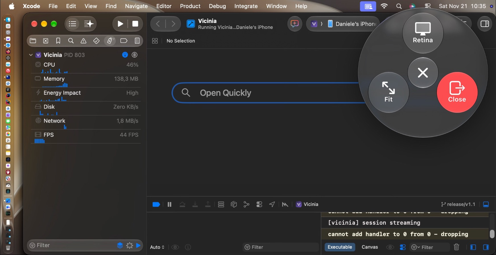

# Vicinia

Vicinia is a native iPhone and iPad app for accessing your Mac over the local
network. It uses Apple's High Performance Screen Sharing (HPSS) protocol.

You can work on your Mac directly from the touchscreen or use a keyboard,
mouse or trackpad.

## Vicinia 2.0 Alpha

This experimental branch introduces remote audio playback and bidirectional clipboard synchronization.

Vicinia 2.0 is under active development. Features and behavior may change before the stable release.

For the current stable version, see the `main` branch.

### What's new in 2.0 Alpha

- Remote audio playback with audio/video synchronization.
- Manual and opt-in automatic bidirectional clipboard synchronization.
- Updated radial session controls with dedicated Audio and Keyboard menus.

Clipboard synchronization supports text, web URLs, rich text, HTML, and images within payload and dimension limits. Rich-text interoperability may vary between applications. File transfers are not yet supported.

The observed HPSS clipboard exchange does not provide a confirmed request/reply correlation mechanism. Under certain conditions, a late reply may replace local clipboard content with stale remote data. See [HPSS Protocol Documentation](Docs/HPSS_PROTOCOL.md) for further details.

This Alpha build has passed automated simulator tests and device-build verification. Physical-device and real-Mac interoperability testing of this public build has not yet been performed.

## Features

- High Performance Screen Sharing in Adaptive mode.
- Hardware-accelerated HEVC decoding, including 4:4:4, with Metal rendering.
- Encrypted connections with host-key verification.
- Remote mouse and keyboard input, with pointer lock.
- Pinch to zoom and pan around the desktop.
- Radial immersive session controls with Retina, Fit and Close actions.
- Five-second auto-hide, with a two-finger double tap to show the controls.

Vicinia 1.1 connects directly to your Mac over the local network. It does not
require Internet port forwarding.

## What's new in Vicinia 1.1

Version 1.1 replaces the previous floating toolbar with compact **radial
immersive controls**, keeping the remote desktop clear when you are working.

- **Retina** opens session settings: Retina or More Space display mode,
  one-finger local pan, Trackpad or Direct input, and the on-screen keyboard.
- **Fit** resets the local zoom and pan to show the full remote desktop.
- **Close** ends the remote session and returns to the connection screen.
- The **X** in the center dismisses the menu without disconnecting.

Double-tap anywhere on the remote desktop with **two fingers** to show or hide
the radial controls. They also hide automatically after **five seconds of
inactivity**. The former Esc and HUD buttons are no longer part of the release
controls; Escape remains available from the on-screen keyboard accessory bar
or a physical keyboard.



## Requirements

- iPhone or iPad running iOS or iPadOS 27 or later.
- A Mac running macOS 27 or later with Screen Sharing enabled.

To build the app, you'll need Xcode 27 or later and Swift 6.4 or later.

## Getting started

Enable Screen Sharing on your Mac, then open Vicinia on your iPhone or iPad.
Enter your Mac's IP address or hostname and your macOS username and password.

The first time you connect, Vicinia asks you to verify the Mac's key fingerprint
before trusting it. The key is saved for future connections.

Once connected, double-tap with two fingers to show or hide the radial controls.
Tap **Retina** to adjust display and input settings, **Fit** to reset the local
view, or **Close** to disconnect. The controls disappear automatically after
five seconds of inactivity.

See the [user manual](Docs/v1/USER_MANUAL.md) for setup instructions, gestures
and troubleshooting.

## Building from source

First, build the C dependencies from the repository root:

```sh
./build-deps.sh
```

The script builds OpenSSL 3.5.9 (`libcrypto`) and libSRTP 2.8.1 for arm64 iOS
devices and simulators. The dependencies are built locally in `Vendor/`.

Open `Vicinia.xcodeproj` in Xcode, select the Vicinia scheme and choose your
device or simulator. Set up code signing if you're building for a physical
device.

You can also build from the command line:

```sh
xcodebuild -project Vicinia.xcodeproj -scheme Vicinia -configuration Debug \
  -destination 'id=<simulator-udid>' -derivedDataPath build/standard-debug build
```

For a physical device, use its UDID instead and add
`-allowProvisioningUpdates`. The Metal shaders are compiled at runtime, so
there's no need to install the separate Metal Toolchain.

## Testing

The repository includes Swift regression tests. To run them, open
`Vicinia.xcodeproj` in Xcode and choose Product > Test, or run from the
command line:

```sh
xcodebuild -project Vicinia.xcodeproj -scheme Vicinia -configuration Debug \
  -destination 'platform=iOS Simulator,name=iPhone Air' -derivedDataPath build/test test
```

To run the tests on a connected device, use its UDID as the destination
instead. The suite contains 174 tests; one hardware-decoding test is skipped
on simulators.

## License

Vicinia is released under the [MIT License](LICENSE).

See [THIRD_PARTY_NOTICES.md](THIRD_PARTY_NOTICES.md) for the licenses of the
third-party components used by the app.
